# Kiến trúc như đã xây (AS-BUILT)

Bản vẽ khớp với **code đang chạy và đã kiểm** trên `rebuild/v2` (D45, [CHANGE_CONTROL.md](../CHANGE_CONTROL.md) §7).
[SYSTEM_DESIGN.md](SYSTEM_DESIGN.md) là ý định (bản phác thảo và lộ trình); tài liệu này là hiện trạng. Khi hai bản nói khác
nhau, AS_BUILT thắng về hiện trạng, SYSTEM_DESIGN thắng về ý định, và chỗ lệch được nêu ở mục "Lệch so với thiết kế" của
từng package (trỏ tới D\*/O\*/DV\*).

Mọi câu về code dưới đây được viết sau khi đọc file nguồn. Câu nào chưa kiểm được ghi **UNVERIFIED**. Bằng chứng SITL
(`run:<id>`) tra ở [2026-10-s1b-sitl-runs.md](../analysis/2026-10-s1b-sitl-runs.md); trạng thái ở
[TRACEABILITY.md](../TRACEABILITY.md).

## System (as built, S1b)

Bốn process ROS 2 của sản phẩm và harness SITL, lấy từ `src/uavnav_bringup/launch/s1_estimation.launch.py`,
`tools/uavnav/sitl_hover.sh`, các node và `uavnav/ros/qos.hpp`. Nét đứt, nền xám: **chưa xây** (không có code trên nhánh).

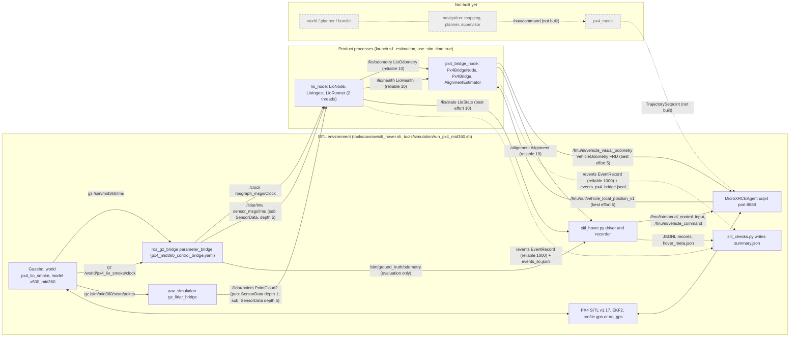

**Miền thời gian (như trong code).**

| Kiểu (`uavnav/core/time.hpp`) | Nguồn ở S1b | Dùng ở |
|---|---|---|
| `SensorTime` | stamp của `/lidar/imu`, `/lidar/points` (đồng hồ sim `/clock`, D29) | lifecycle, predictor, alignment, mọi `stamp` LIO và `/alignment` |
| `RosTime` | `rclcpp::Clock` của node (use_sim_time: `/clock`; 0 trước `/clock` đầu tiên) | `t_ros_ns` của event, chờ IMU 100 ms của ingest, tick 100 ms của bridge |
| `Px4Time` | `to_px4(SensorTime, kSimulationIdentity)`: **đồng nhất** với SensorTime; `kRealtime` bị từ chối | `VehicleOdometry.timestamp_sample` (µs) |
| `SteadyTime` | `std::chrono::steady_clock` | `t_steady_ns` của event |

So sánh SensorTime với RosTime trực tiếp (ngưỡng stamp tương lai) chỉ đúng vì SITL dùng một trục thời gian (D29).

**Luồng event.** Mỗi process có đúng một `EventRecorder` (ring 4096, writer 20 ms) ghi qua `TeeSink(JsonlSink,
RosEventSink)`: file JSONL trong thư mục chạy và topic `/events`. `sitl_checks.py` đọc hai file JSONL (không đọc `/events`).

**Chưa xây** (không có package trên nhánh): `navigation` (mapping, planner, supervisor), `px4_mode`, `uavnav_world`,
`uavnav_planning`, `/nav/command`, `/lio/scan` (hoãn S3, D33/O25), bên gọi `LioRunner::restart` (S1c, D41), offer seed
`/lio/restart_seed` (O29). `NavCommand`, `MissionDefinition`, `Waypoint` đã có kiểu message nhưng không có bên phát hay
bên nhận. Các package cũ đã track `src/common/navigation_common`, `src/contracts/navigation_mission` và
`config/runtime/*` không nằm trong đồ thị phụ thuộc của bốn process (không `package.xml` hay loader nào của sản phẩm
trỏ tới; kiểm bằng grep).

## uavnav_core

Thư viện C++ thuần (không ROS, `allowed_deps: []`): kiểu thời gian theo miền, `Result`, bản ghi event và recorder có
thread writer, các sink, loader tham số tầng (b), hàng đợi SPSC không khoá, `wrap_pi`.

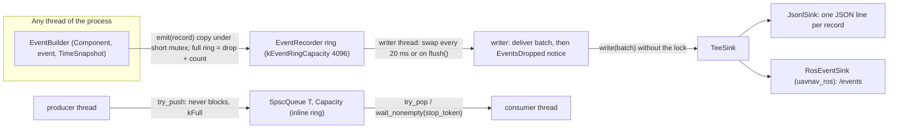

| Header | Có gì (đọc từ code) |
|---|---|
| `time.hpp` | `Duration`, `TimePoint<Tag>`; `SensorTime`, `RosTime`, `SteadyTime`, `Px4Time`; `TimeSnapshot{steady, ros}`; không chuyển đổi ngầm, không kiểm tràn (UB có chủ đích, phải kiểm trước) |
| `time_convert.hpp` | `from_stamp<Tag>(sec, nanosec)`, `duration_from_seconds`; `TimeError` (`NEGATIVE_SECONDS`, `NANOSECONDS_OUT_OF_RANGE`, `NOT_FINITE`, `OUT_OF_RANGE`); `kMaxStampSeconds` 9e9 |
| `result.hpp` | `Result<T,R> = std::expected`; concept `ReasonEnum` (enum có `to_string`) |
| `event.hpp`, `event_builder.hpp` | `EventRecord` (trivially copyable, `values[16]`, chuỗi chỉ trỏ vùng nhớ tĩnh), `Component` (`core`, `lio`, `px4_bridge`, `mapping`, `planner`, `supervisor`, `px4_mode`), `EventIdentity` |
| `event_recorder.hpp` | `EventRecorder::create(sink, capacity)`, `emit` (không chờ), `flush`, `stats` (`emitted`, `written`, `dropped`, `sink_failures`) |
| `jsonl_sink.hpp`, `tee_sink.hpp` | file JSONL (NaN/inf → `null`), fan-out hai sink |
| `config.hpp` | `ParamSpec{key, unit, min, max}`, `load_params(_file)`: map phẳng, key có hậu tố đơn vị, không mặc định, không kẹp; `ConfigError::Kind` 10 loại; file ≤ 1 MiB |
| `spsc_queue.hpp` | `SpscQueue<T, Capacity>`: một producer, một consumer, `try_push` → `kFull`, `wait_nonempty(stop_token)` bằng `atomic::wait` |
| `limits.hpp` | `kMaxEventValues` 16, `kEventRingCapacity` 4096, `kEventWriterPeriod` 20 ms |

**Thread và khoá.** `EventRecorder`: một `std::mutex` cho ring và thống kê; writer thread đổi ring lấy batch rỗng rồi
gọi sink **ngoài khoá**; destructor đặt `stop_`, writer xả ring rồi thoát, `join`. Sink lỗi hay ném ngoại lệ: mất batch đó,
đếm `sink_failures`. `SpscQueue`: không khoá, chỉ số `head_`/`tail_` acquire/release trên cache line riêng.

**Bằng chứng.** `test_time`, `test_time_convert`, `test_result`, `test_event_recorder`, `test_jsonl_sink`,
`test_golden_jsonl`, `test_tee_sink`, `test_config`, `test_spsc_queue` (`SpscQueue.ConcurrentProducerConsumerAccountsForEveryItem`,
`SpscQueue.FullPushNeverBlocks`), `test_angles`; TSan qua `make sanitize` (TRACEABILITY, dòng tách LIO). Chạy thật trong
mọi lần SITL: event `EventsDropped` bị `sitl_checks.py` coi là lỗi (`ZERO_TOLERANCE_EVENTS`), các hover PASS.

**Lệch so với thiết kế.**
- §6.1: thiết kế nói "ring buffer + writer ghi ra `/events` và JSONL"; code đúng như vậy, nhưng việc ghi `/events` nằm ở
  `uavnav_ros::RosEventSink`, không ở core (core không có ROS, đúng ý D33/O19).
- §6.3: "mỗi cycle tạo một `TimeSnapshot`" là quy ước của bên gọi; core không ép được (không có kiểm).
- §6.2 tầng (b): loader thuần có; struct có kiểu chỉ có cho LIO, node lio và alignment (TRACEABILITY "Config ba tầng").

**Chưa xây / giới hạn đã biết.** Không có `TimeSnapshot` cho `SensorTime`/`Px4Time` (chỉ steady và ROS). Không có
script KPI (S5). Lỗi tràn int64 của phép thời gian không được kiểm ở tầng này (hợp đồng: bên gọi kiểm phạm vi trước).

Verified at: `d3eed88`

## uavnav_interfaces

Gói message ROS 2 (`rosidl`), phụ thuộc `builtin_interfaces`, `geometry_msgs`. Tám message; chỉ bốn có bên phát/nhận ở S1b.

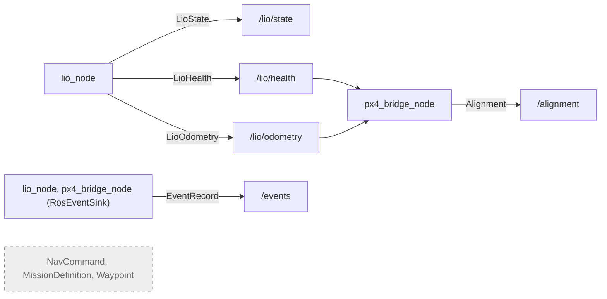

| Message | Trường quan trọng | Miền thời gian và quy ước (theo comment trong `.msg` và code) |
|---|---|---|
| `LioState` | `stamp`, `epoch`, `reset_counter`, `lio_state` (hằng của `LioHealth`), `pose`, `velocity`, `angular_velocity`, `pose_covariance[36]`, `velocity_covariance[9]`, `reset_delta_position/velocity/yaw` | `stamp`: SensorTime. Pose trong `lio_odom`, vận tốc và vận tốc góc trong `base_link`. Node điền covariance bằng NaN |
| `LioHealth` | `INITIALIZING=0..RESTARTING=4`, `state`, `epoch`, `reason`, `reason_name`, hai trị riêng nhỏ nhất, `correction_age_s`, ba sai số output | `stamp`: SensorTime của mẫu IMU mới nhất được đánh giá. Hằng số = `lio::LioState` (static_assert ở `ros_conversion.cpp`) |
| `LioOdometry` | `stamp`, `epoch`, `reset_counter`, `pose`, `velocity`, `pose_covariance[36]`, `velocity_covariance[9]`, `quality` 0–100 | `stamp`: SensorTime cuối scan; frame `lio_odom` (FLU) |
| `Alignment` | `INIT=0, VALID=1, FROZEN=2, INVALID=3`, `T` lọc (`x_m..yaw_rad`), `T` tức thời `raw_*` (NaN khi không có cặp), `age_s`, `residual_position_m`, `residual_yaw_rad` | `stamp`: SensorTime của mẫu LIO trong cặp mới nhất. `T`: `lio_odom` **FRD** → PX4 local NED; residual đo tại vị trí xe |
| `EventRecord` | `t_steady_ns`, `t_ros_ns`, `component`, `event`, `state_before/after`, `reason`, identity, `value_keys[]`, `values[]` | ánh xạ 1:1 `events::EventRecord` |
| `NavCommand` | P/V/A, yaw, `phase` MAIN/BACKUP/BRAKE/HOLD, `lease_ns`, `sample_time_ns` | RosTime. **Không có bên dùng** |
| `MissionDefinition`, `Waypoint` | frame GPS/LOCAL, yaw mode, waypoint | **Không có bên dùng** |

**Bằng chứng.** Build của gói trong `tools/uavnav/gate.sh`; dùng thật trong mọi hover SITL (bốn topic được ghi bởi
`sitl_hover.py`): `run:20261013T232211Z-gps-hover`. Hằng trạng thái khớp enum được ép bằng `static_assert`.

**Lệch so với thiết kế.** §6.5 liệt kê `LioState`, `LioHealth`, `LioOdometry`, `Alignment`, `NavCommand`, `EventRecord`,
`MissionDefinition`: có đủ, thêm `Waypoint`. Không có message `LioRestartSeed` (O29 chưa chốt) và không có `/lio/scan` (O25).

**Chưa xây / giới hạn.** `LioOdometry` không có `header.frame_id`; frame chỉ ghi trong comment. `Alignment.msg` ghi
`T` từ `lio_odom (FRD)`: bên dùng phải đổi FLU→FRD trước khi áp `T`.

Verified at: `d3eed88`

## uavnav_ros

Tiện ích vỏ ROS dùng chung (D33/O19), phụ thuộc `uavnav_core`, `uavnav_interfaces`: bảng QoS sản phẩm, đổi stamp có kiểm
phạm vi, và sink `/events`.

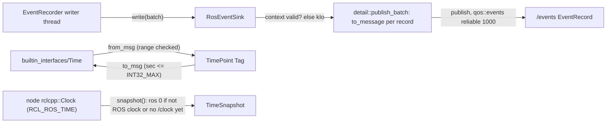

| Hàm/profile (`uavnav/ros/*.hpp`) | Giá trị trong code |
|---|---|
| `qos::sensor_input()` | `SensorDataQoS().keep_last(5)` (best effort) |
| `qos::state_output()` | keep last 10, best effort, volatile |
| `qos::reliable_output()` | keep last 10, reliable, volatile |
| `qos::events()` | keep last 1000, reliable, volatile |
| `qos::px4()` | keep last 5, best effort, volatile |
| `from_msg<Tag>`, `to_msg<Tag>`, `snapshot(clock)` | lỗi là `TimeError`; `snapshot` không ném, `ros = 0` khi chưa có giờ ROS |
| `RosEventSink::create(node)`, `write(batch)` | publisher tạo trên thread của node; `write` chạy trên writer thread của recorder, không khoá riêng |

**Thread và tắt.** Sink giữ publisher và context, không giữ node; recorder phải bị huỷ trước node và trước
`rclcpp::shutdown()` (cả hai node làm đúng thứ tự này, xem phần node). Kiểm `context->is_valid()` rồi mới publish có
TOCTOU đã ghi trong header: batch cuối có thể mất im lặng nếu context tắt giữa hai bước.

**Bằng chứng.** `RosQos.ProductProfilesMatchTheDesign`, `RosQos.SensorInputIsTheSensorDataProfile`,
`RosTime.FromMsgIsRangeChecked`, `RosTime.ToMsgRefusesWhatTheMessageCannotHold`, `RosTime.SnapshotRosIsZeroForAClockThatIsNotRosTime`,
`RosEventSink.WriteAfterContextShutdownReturnsIo`, `EventsFixture.PublishesFromTheRecordersWriterThread`. SITL: hai node
phát `/events` trong mọi hover (`run:20261013T163717Z-gps-hover`).

**Lệch so với thiết kế.** Khớp §6.5/O21 về QoS. Comment của `qos::sensor_input()` còn ghi tên topic cũ
`/livox/lidar, /livox/imu`; topic thật là `/lidar/points`, `/lidar/imu` (chỉ là comment).

**Chưa xây / giới hạn.** Không có bộ chuyển đổi cho `Px4Time` (bridge tự làm `from_px4_us`). `/events` không được
harness đọc; chỉ JSONL được kiểm.

Verified at: `d3eed88`

## fast_lio_core

Toán FAST-LIO được giữ lại (D20 "giữ"), thuần C++ (Eigen, OpenMP), namespace `uav::nav::lio`, phụ thuộc
`ikfom_vendor`, `ikd_tree_vendor`. Không có thread riêng, không đọc đồng hồ, không phát event; chỉ backend của
`uavnav_lio_core` gọi vào.

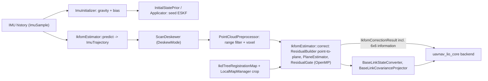

| Phần còn lại | File | Bên dùng trong sản phẩm |
|---|---|---|
| ESKF trên manifold (IKFoM): `predict`, `correct`, `reset`, `rebase` | `estimation/ikfom_estimator.*`, `manifold_state.*`, `ikfom_state.*`, `imu_trajectory.*` | backend |
| `IkfomCorrectionResult::information`: khối 6×6 trên-trái của HᵀR⁻¹H của vòng lặp cuối (tịnh tiến 0:3, xoay 3:6) | `ikfom_estimator.hpp` | backend → `evaluate_degeneracy` |
| Khởi tạo IMU tĩnh, prior và seed | `initialization/*` | backend (khởi tạo, restart) |
| Deskew, tiền xử lý, residual point-to-plane | `deskew/*`, `preprocessing/*`, `registration/*` | backend |
| Map ikd-tree, crop local map (`crop_trigger_distance_m` 5.0, `absolute_map_point_guard` 250000 mặc định) | `mapping/*` | backend |
| Đổi trạng thái IMU sang `base_link` và covariance | `navigation/base_link_*` | backend (odometry) |
| `AngularVelocityResolver`, `transform_utils` | `navigation/angular_velocity_resolver.*`, `geometry/transform_utils.*` | **không có bên dùng** ngoài test (grep) |

Cấu hình: chỉ các khoá trong `EstimatorMathConfig` được nạp từ `config/lio/sim.yaml` (qua `kLioSpecs`); mọi núm khác giữ
mặc định của struct trong `fast_lio_core` (ví dụ `IkfomEstimatorConfig::maximum_iterations` 4 bị ghi đè bằng
`registration_max_iterations`). Số thread OpenMP do backend đặt: `kIcpThreads` 3 (1 trong bản TSan).

**Bằng chứng.** 19 test gtest trong `src/estimation/fast_lio_core/test/` (ví dụ `test_ikfom_estimator`,
`test_ikfom_compact_equivalence`, `test_residual_builder`, `test_scan_deskewer`, `test_registration_map`); dùng thật trong
mọi hover SITL qua backend (`run:20261013T232211Z-gps-hover`).

**Lệch so với thiết kế.** Khớp §3 "giữ IKFoM ESKF, ikd-tree, residual point-to-plane, toán propagation". Gói mang theo
kiểu thời gian riêng (`fast_lio_core/time/*`, `Timestamp`, `ClockDomain`) song song với `uavnav::time`; backend đổi qua
lại ở ranh giới (`stamp()` trong `backend.cpp`). Hai kiểu thời gian là nợ kỹ thuật, không có D\* nào ghi nhận (UNVERIFIED
là có chủ đích).

**Chưa xây / giới hạn.** Không có relocalize vào map cũ (§8). ikd-tree chạy không có thread rebuild bất đồng bộ (theo
comment `backend.hpp`).

Verified at: `d3eed88`

## uavnav_lio_core

Lõi LIO thuần (không ROS), phụ thuộc `uavnav_core`, `fast_lio_core`. Tách hai khối (D30, D31, D32): `LioFrontend` (thread
ingest: predictor, lifecycle, kiểm gap, dựng output) và `LioBackend` (thread estimator: toàn bộ toán FAST-LIO, suy biến),
nối bằng hai `SpscQueue`. `LioRunner` là lớp ghép hai thread của sản phẩm. `LioPipeline` (đồng bộ, một thread) chỉ cho
test và replay; node không dùng nó.

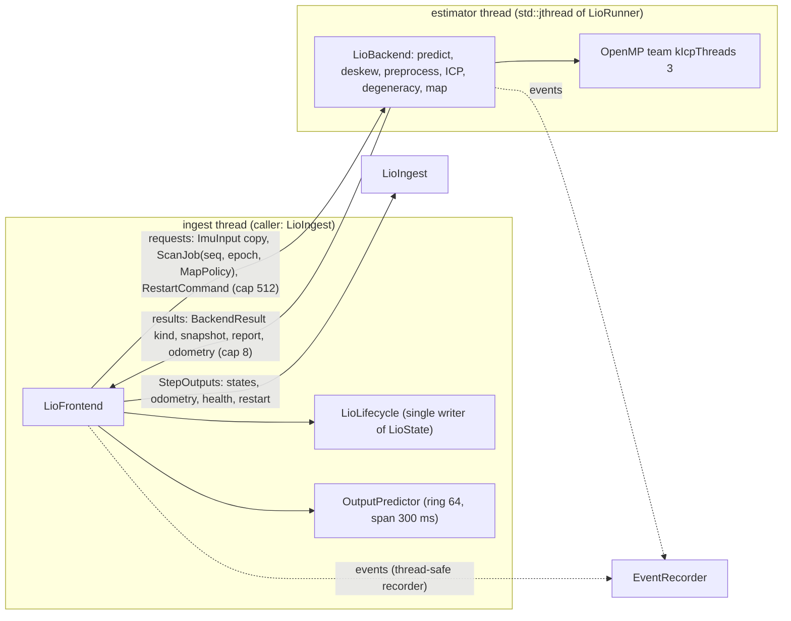

**Lifecycle như trong code** (`lifecycle.hpp` `kLioTransitions`, `lifecycle.cpp`). Thứ tự xét trong mỗi trạng thái:
sigma vị trí trước, rồi tới sự kiện. Gap chỉ xét trên `kImuTick`.

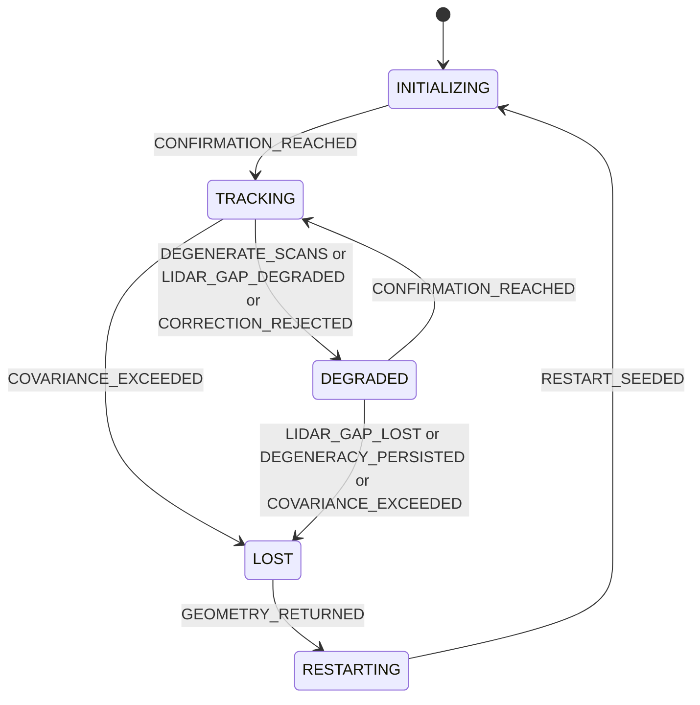

| Từ | Tới | Reason | Điều kiện trong code (giá trị beta `config/lio/sim.yaml`) |
|---|---|---|---|
| INITIALIZING | TRACKING | `CONFIRMATION_REACHED` | sau `kMapReady` (trả reason `MAP_READY`, không đổi trạng thái), `confirm_scans` (5) `kScanGood` **tươi** liên tiếp (guard tươi, dưới bảng); scan xấu hay scan tốt cũ đặt lại bộ đếm; scan trước `kMapReady` bị bỏ qua; sigma và gap không xét |
| TRACKING | DEGRADED | `DEGENERATE_SCANS` / `CORRECTION_REJECTED` | `degenerate_scans` (3) scan xấu liên tiếp (degenerate, empty, correction-rejected); reason theo loại của scan hoàn tất chuỗi |
| TRACKING | DEGRADED | `LIDAR_GAP_DEGRADED` | `kImuTick` với `t − last_scan > gap_degraded` (0.25 s, so sánh chặt) |
| TRACKING, DEGRADED | LOST | `COVARIANCE_EXCEEDED` | ở **mọi** sự kiện: `!(0 ≤ sigma ≤ position_sigma_lost_m)` (0.5 m); NaN là vượt |
| DEGRADED | TRACKING | `CONFIRMATION_REACHED` | `confirm_scans` (5) `kScanGood` **tươi** liên tiếp; scan xấu hay scan tốt cũ đặt lại bộ đếm |
| DEGRADED | LOST | `DEGENERACY_PERSISTED` | scan xấu với `t − degenerate_since > degeneracy_lost` (1.0 s); `degenerate_since` giữ qua cạnh TRACKING → DEGRADED |
| DEGRADED | LOST | `LIDAR_GAP_LOST` | `kImuTick` với `t − last_scan > gap_lost` (0.5 s) |
| LOST | RESTARTING | `GEOMETRY_RETURNED` | **một** `kScanGood` (scan đăng ký trên map đóng băng `MapPolicy::kFrozen`); mọi sự kiện khác bị bỏ qua |
| RESTARTING | INITIALIZING | `RESTART_SEEDED` | backend trả `kRestartSeeded` cho một `restart(seed)` từ ngoài; epoch + 1 |

**Guard tươi trên cạnh xác nhận (D40, AR4; `lifecycle.cpp` `fresh()`).** `LioLifecycle` giữ `last_imu_t_`, stamp
`kImuTick` mới nhất đã thấy (dữ liệu, không phải cờ; `go()` không đặt lại). Ở INITIALIZING (đang xác nhận) và DEGRADED,
một `kScanGood` chỉ được đếm vào `confirm_scans` khi `last_imu_t_ − scan end + kScanPeriod ≤ gap_degraded` (0.15 s ở
beta; bằng thì đếm): luật gap phải còn giữ khi kết quả kế tiếp trễ như kết quả này (review T2 I1, dải DV1). Scan
tốt cũ hơn đặt bộ đếm về 0, nhưng vẫn đẩy `last_scan_time()` và xoá chuỗi suy biến (output đã được hiệu chỉnh tới scan
end đó). Chưa có tick nào thì mọi scan là tươi. Vì frontend áp kết quả trước khi tick mẫu IMU của chính lời gọi đó,
`last_imu_t_` là mẫu mới nhất **đã tick**.

`last_scan_time()` chỉ tiến với scan good/degenerate/empty, không với `kScanCorrectionRejected` (D31). Không có cạnh
LOST → TRACKING (`static_assert`). `go()` từ chối mọi cạnh không có trong bảng. Reason `SCAN_ACCEPTED`, `SCAN_EMPTY` có trong
enum nhưng không bao giờ được trả.

**Quy tắc nhận/từ chối kết quả scan như trong code** (`frontend.cpp` `apply`, `apply_scan`; mỗi bước sai thì dừng):

| # | Kiểm | Hậu quả |
|---|---|---|
| 1 | kết quả scan phải trả lời scan cũ nhất đang bay (`seq`) | sai: `LioResultDiscarded` `UNEXPECTED_SEQUENCE` |
| 2 | `epoch == requested_epoch` và (là câu trả lời restart ⇔ đang chờ restart) | sai: `LioResultDiscarded` `STALE_EPOCH` |
| 3 | `kScanGood`: `OutputPredictor::on_correction(snapshot)` (thiếu snapshot thì như `NON_FINITE`). Đây là **từ chối duy nhất** của một hiệu chỉnh (D40, AR4); tuổi không bao giờ là lý do | lỗi (`NOT_INITIALIZED`, `OLDER_THAN_BUFFER`, `NEWER_THAN_OUTPUT`, `NON_FINITE`): `PredictorCorrectionRejected`, thành `kScanCorrectionRejected` (không đẩy mốc gap); được áp: output được hiệu chỉnh, `correction_age` tính từ scan end này |
| 4 | đưa `LioEvent{kind, scan end, sigma}` vào lifecycle (guard tươi quyết định scan có được đếm vào xác nhận) | `StateTransition` nếu đổi trạng thái; health kèm theo |
| 5 | odometry chỉ khi hiệu chỉnh đã được áp **và** trạng thái sau bước 4 là TRACKING | `OdometryOutput` (stamp = scan end, `epoch`, `reset_counter` của predictor, `quality`) |

Hệ quả đã kiểm:
- backend bão hoà với kết quả cũ 0.27 s mỗi 100 ms: DEGRADED (luật gap), không về TRACKING, không LOST, không odometry,
  output bám registration (sai số lớn nhất 0.017 m trong giây cuối của test);
- backend bão hoà thực tế (ICP 135 ms, tối đa 2 scan đang bay, mỗi scan thứ tư bị `BACKEND_BUSY`, kết quả cũ 0.17–0.26 s):
  một cạnh TRACKING → DEGRADED rồi ở DEGRADED, không dao động, không LOST (guard của `8c9ad29`, không có biên một chu kỳ
  scan, dao động 6 lần đổi trạng thái trong 3 s).
Kết quả cũ hơn `gap_degraded` chỉ tới được khi đã rời TRACKING (tick làm nó cũ đã kích hoạt luật gap).

Câu trả lời restart (`apply_restart`): `kRestartRejected`, thiếu snapshot, hoặc predictor không còn `covers()` thời điểm
lệnh (D33/O16) → `LioRestartRejected`, ở lại RESTARTING; ngược lại `reset_to`, epoch mới, `LioRestart`, lifecycle
`kRestartSeeded`.

**Phát output.** `/lio/state`: một `StateOutput` cho mỗi mẫu IMU không trùng sau khi predictor được căn
(`kImuInitialized`). Health: ở mỗi lần đổi trạng thái và trên lưới 100 ms thời gian IMU (`kHealthPeriod`). Map: chèn khi
`kMapBootstrap` hoặc `kScanGood` với `kInsert` (INITIALIZING/TRACKING/DEGRADED); đóng băng ở LOST/RESTARTING.

| Hằng tầng (a) (`uavnav/lio/limits.hpp`) | Giá trị |
|---|---|
| `kBackendRequestCapacity` / `kBackendResultCapacity` | 512 / 8 |
| `kMaxScansInFlight` | 2 (scan thứ ba bị từ chối `BACKEND_BUSY`, bỏ mới nhất) |
| `kPredictorBufferSpan` / `kPredictorBufferCapacity` / `kPredictorDtMax` | 300 ms / 64 / 30 ms |
| `kImuHistoryCapacity`, `kHealthPeriod`, `kMaxScanPoints` | 1024, 100 ms, 200000 |
| `kScanPeriod` / `kGapDegradedMin` | 100 ms / 200 ms (hai chu kỳ scan; cận dưới của `lifecycle_gap_degraded_s`, node `lio` `static_assert` theo nó) |
| `kRebaseCovarianceInflation`, `kEventSummaryEvery`, `kIcpThreads` | 10, 1000, 3 (1 khi TSan) |

Tầng (b): 23 khoá `kLioSpecs` (`config.hpp`) đọc từ `config/lio/sim.yaml` bằng `load_lio_config` (`lifecycle_gap_degraded_s`
trong [0.2, 2.0] s, cận dưới là `kGapDegradedMin`; kiểm chéo khi nạp: `lifecycle_gap_lost_s ≥ kPredictorBufferSpan + 2 ×
kScanPeriod` = 0.5 s, đúng bằng giá trị beta, để backend bão hoà mà kết quả còn đặt được vào buffer không tới LOST); tách thành
`FrontendConfig` (lifecycle, `predictor_tau_vel_s`/`_pos_s` 0.25, `imu_max_gap_s`) và `BackendConfig` (toán,
`degeneracy_translation_min_info` 1.1e5, `degeneracy_rotation_min_info` 2.8e6).

**Thread, khoá, tắt.** Không khoá nào trong lõi; hai thread chỉ chia hai hàng đợi SPSC và recorder. Mọi API ingest phải
gọi từ một thread. `LioRunner::create` khởi động `std::jthread` ở bước cuối. `stop()`: `request_stop` + `join` (backend trả
về sau request đang làm, phần còn lại của hàng đợi không xử lý). Destructor: `stop()`, rồi huỷ backend, frontend, cuối
cùng channels. Clock của backend ném: `LioClockFailed`, chạy tiếp. Ngoại lệ thoát `LioBackend::run`: `LioBackendFailed`,
flush recorder, `std::terminate`.

**Event (component `lio`).** Backend: `LioScan`, `EskfRebased`, `ImuInitialized`, `ImuInitRejected`, `OdometryInvalid`,
`AllocationFailed`, `LioQueueOverflow` (`RESULT_QUEUE_FULL`), `RestartSeedRejected`. Frontend: `StateTransition`,
`LioRestart`, `LioRestartRejected`, `PredictorCorrectionRejected`, `LioInputRejected`,
`LioQueueOverflow`, `LioResultDiscarded`, `ImuGap`, `ImuDuplicate`, `ImuRateTooHigh`, `AllocationFailed`. Runner:
`LioClockFailed`, `LioBackendFailed`. Catalogue đầy đủ ở đầu `uavnav/lio/types.hpp`.

**Bằng chứng.** `LioLifecycleTable.NoEdgeFromLostToTracking`, `LioLifecycle.TransitionsAlwaysFollowTheTable`,
`LioLifecycle.LidarGapOnImuTicksAloneReachesLost`, `LioLifecycle.LostGoodScanStartsRestarting`,
`LioLifecycle.CorrectionRejectedCountsLikeDegenerateButKeepsTheGapReference`,
`LioLifecycle.StaleGoodScanMovesTheGapReferenceButNeverConfirms`, `LioLifecycle.FreshGoodScansStillConfirm`,
`LioFrontend.ResultOlderThanGapDegradedIsAppliedToTheOutput`, `LioFrontend.SaturatedBackendStaysDegradedWithACorrectedOutput`,
`LioFrontend.ResultAgeUsesTheNewestTickedImuSample`, `LioFrontend.SaturatedBackendWithTwoScansInFlightNeverFlaps`,
`LioConfig.GapDegradedBelowTwoScanPeriodsIsRejected`, `LioConfig.GapLostBelowBufferPlusTwoScansIsRejected`,
`LioFrontend.RejectedCorrectionDoesNotHoldTracking`,
`LioFrontend.LateRestartAnswerIsRefusedAndStaysRestarting`, `LioFrontend.StalledBackendStillReachesLostOnImuTime`,
`LioRunner.BlockedBackendDoesNotDelayGapCheckOrStateOutput`, `LioRunner.LateRestartAnswerIsRefusedAndARetrySucceeds`,
`LioSplit.BackendHeadersCompileWithoutTheLifecycle`, `OutputPredictor.CorrectionConvergesWithoutJump`; TSan trên
`LioRunner` (`make sanitize` ở `681c783`: `uavnav_lio_core` 238 test, không có cảnh báo). Kiểm đột biến guard tươi, biên
một chu kỳ scan, kiểm chéo `gap_lost` và việc bỏ quy tắc tuổi (S1c Task 2 và vòng sửa 1): 15/15 đột biến của lõi bị bắt. SITL: `run:20261013T152418Z-gps-hover` (`/lio/state` 100 Hz, tuổi kết quả p99 28 ms, 0 lần
DEGRADED → TRACKING), `run:20261013T162711Z-gps-altitude_sweep` (đường DEGRADED → LOST thật ở 4.76 m).

**Lệch so với thiết kế.**
- §3.1 (sơ đồ đích D41) **chưa có trong code**: code giữ sơ đồ S1b. LOST → RESTARTING xảy ra ngay ở một scan tốt trên
  map đóng băng (`GEOMETRY_RETURNED`), không có chờ dữ liệu ổn định `restart_stable_s` (`STABLE_DATA_DWELL`), không có
  cạnh INITIALIZING → LOST (`REINIT_NOT_CONFIRMED`). Chờ S1c Task 3 (D41, AR4).
- §3.1/§3.5 D40 (AR4): **đã có** ở `8c9ad29` và `681c783`: không còn quy tắc tuổi; từ chối duy nhất là `on_correction` của
  predictor; guard tươi trên cạnh xác nhận, có biên một chu kỳ scan. Không có hàm `CorrectionVerdict` (AR4 bỏ nó). Spec
  §3.1 còn ghi guard không có biên `kScanPeriod` (chờ controller cập nhật). Dải DV1: kết quả cũ hơn `gap_degraded −
  kScanPeriod` không còn được đếm vào xác nhận; trạng thái DV1 do controller ghi.
- §3.2 nói ngưỡng suy biến "có hysteresis": `evaluate_degeneracy` **không có hysteresis** (so sánh từng scan với một
  ngưỡng); chỉ chuỗi 3 scan / 5 scan của lifecycle làm giảm dao động.
- §3.4: lệnh restart "do frontend phát" (D41) chưa có; `restart()` chỉ được gọi từ test. Không có seed `SYNC`/`SELF`.
- Đúng với §3.3 (predictor, buffer 300 ms, quy tắc khớp O18), §3.5 (hai khối, ranh giới D32 ở compile time, hàng đợi tràn
  là event).

**Chưa xây / giới hạn.** Không có test cho đường worker chết (`LioBackendFailed`). Trong RESTARTING không ai gọi
`restart`, nên ở S1b một lần LOST rồi có scan tốt sẽ **đứng ở RESTARTING tới hết chuyến** (đúng O25: "LIO LOST ở lại
RESTARTING"). Trong LOST, `kScanGood` trên map đóng băng vẫn được đưa vào predictor (bước 3) trước khi lifecycle chuyển
RESTARTING.

Verified at: `681c783`

## uavnav_lio

Vỏ ROS của LIO (D33/O19): thư viện ingest thuần `LioIngest` (người gọi duy nhất của `LioRunner`) và node `lio`
(`LioNode`, `lio_node_main.cpp`). Node chỉ đổi message, gác callback và publish; mọi quyết định nằm ở ingest và lõi.

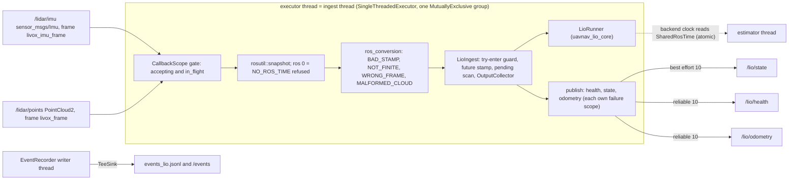

| Giao diện | Giá trị trong code |
|---|---|
| Tham số node (không mặc định) | `config_file` (`config/lio/sim.yaml`, `kLioSpecs`), `node_config_file` (`config/lio/node_sim.yaml`, `kLioNodeSpecs`), `events_jsonl` |
| Subscription | `/lidar/imu`, `/lidar/points`: `qos::sensor_input()` (SensorData, depth 5) |
| Publisher | `/lio/state` `qos::state_output()`; `/lio/health`, `/lio/odometry` `qos::reliable_output()`; `/events` qua `RosEventSink` |
| Frame (tầng a, `lio_node/limits.hpp`) | `lio_odom`, `base_link`, `livox_frame`, `livox_imu_frame` |
| `kStatePeriod` | 10 ms ô SensorTime tuyệt đối → `/lio/state` 100 Hz (IMU 200 Hz) |
| `kScanImuWaitMax` | 100 ms RosTime: một scan chưa được IMU phủ được giữ (một chỗ), hết hạn thì `LioScanDropped` `IMU_COVERAGE_TIMEOUT`; scan mới hơn thay thế (`SUPERSEDED`) |
| `kMaxStampAhead` | 50 ms (D40, AR4): stamp > ROS now + 0.05 s bị từ chối `STAMP_IN_FUTURE`; `static_assert(kMaxStampAhead < kGapDegradedMin − kScanPeriod)` (0.1 s) nên một stamp được nhận không tự gây DEGRADED |
| Tầng (b) node | 6 khoá mount `extrinsic_base_lidar_{x,y,z}_m`, `_{roll,pitch,yaw}_rad` (SITL: z 0.28 m); `base_T_imu = base_T_lidar · imu_T_lidar⁻¹` |

**`/lio/state` như trong code** (`OutputCollector`): pose `base_link` trong `lio_odom`, vận tốc `base_link` trong
`base_link` có tay đòn ω×r, vận tốc góc là gyro thô của mẫu IMU mới nhất xoay sang `base_link`, covariance NaN,
`reset_delta_*` giữ theo lần restart cuối (0 trước lần đầu).

**Thread và gác.** Thread executor là thread ingest. Hai lớp gác: (1) callback group MutuallyExclusive; (2) `LioIngest`
thử vào bằng một compare-exchange, lời gọi chồng bị từ chối `LioIngestReentered`. `SharedRosTime` (atomic int64) là thứ
duy nhất thread estimator đọc từ node. Cổng callback của node: `accepting_` và `in_flight_` (atomic seq_cst).

**Thứ tự tắt (`LioNode::finish`, gọi từ pre-shutdown callback của context hoặc sau `spin()`)**:
1. `accepting_ = false`, chờ callback đang chạy về 0 (ngủ 1 ms mỗi vòng);
2. event `LioNodeSummary` (bộ đếm của node);
3. `LioIngest::stop()`: `LioRunner::stop` join thread estimator, rồi `IngestSummary` (bộ đếm ingest, frontend và hai hàng đợi);
4. huỷ ingest, rồi recorder (writer xả ring vào JSONL và `/events`, join, đóng file);
5. publisher, subscription và node đi cùng đối tượng `LioNode`; `main` gỡ hook, `rclcpp::shutdown()`.

Khởi động sai cấu hình: một `RCLCPP_FATAL`, `LioNodeStartFailed`, thoát mã khác 0, trước khi có thread nào của node.
Ngoại lệ trong callback: `LioNodeFailed`, ném lại cho executor, `main` thoát 1.

**Event (component `lio`).** `LioInputRejected` (`ConversionError`, `NO_ROS_TIME`, `STAMP_IN_FUTURE`), `LioScanDropped`,
`LioIngestReentered`, `LioPublishFailed`, `LioNodeFailed`, `LioNodeSummary`, `IngestSummary` (bản ghi cuối của JSONL).

**Bằng chứng.** `LioIngest.ScanWaitsForImuCoverageThenIsPushed`, `LioIngest.ScanWaitingForImuIsDroppedAfterTheBoundedWait`,
`LioIngest.FutureStampIsRefused`, `LioIngest.OneImuStampFourHundredMsAheadIsRefusedAndNeverReachesLost`,
`LioIngest.ConcurrentCallsAreRefusedNotRaced`, `LioIngest.StateIsBaseLinkPoseAndBodyVelocity`,
`LioNode.InProcessSyntheticRunPublishesAllTopics`, `LioNode.NoRosTimeRefusesEveryMessageBeforeTheIngest`,
`LioNode.ShutdownJoinsTheBackendThenFlushesEvents`, `LioNode.MultiThreadedExecutorKeepsCallbacksSerialised`,
`LioRosConversion.PointCloudDropsNonFinitePointsAndCountsThem`. SITL: `run:20261013T163717Z-gps-hover` (cloud thật 10.00 Hz,
`rejected_wrong_frame` 0, `rejected_malformed_cloud` 0), `run:20261013T152418Z-gps-hover` (`/lio/state` 100 Hz, p99 12 ms).

**Lệch so với thiết kế.**
- §3.5 "Ngưỡng stamp tương lai" (D40, AR4): **đã có** ở `8c9ad29` (50 ms, `static_assert` ở compile time thay vì kiểm khi
  khởi động). `kClockMode` của node thuộc phần cứng (P8), chưa có.
- §3.5 "chờ IMU 100 ms": AR4 giữ nguyên hạn chờ này; code khớp.
- Không có đường nhận offer seed (O29) hay lệnh restart (D41): `LioIngest` không gọi `LioRunner::restart`.
- Chờ IMU 100 ms và từ chối stamp tương lai chưa từng được kích hoạt trong SITL (TRACEABILITY, dòng O20).

**Chưa xây / giới hạn.** `/lio/scan` (O25, S3). Thời gian chờ của publish reliable (`/lio/health`, `/lio/odometry`) khi
reader chậm chưa được đo (ghi trong header). `SharedRosTime` đóng băng khi callback dừng; nó chỉ đóng dấu event của backend.

Verified at: `681c783`

## uavnav_px4_bridge

Hai target (D33/O19): lõi không ROS `uavnav_px4_bridge_core` (`Px4Bridge`, `AlignmentEstimator`, `encode_ev`,
`px4_time`, `frames`, config) và node `px4_bridge` (`Px4BridgeNode`). Bridge gửi EV FRD cho EKF2 khi LIO TRACKING và
ước lượng `T_px4←lio` 4-DoF.

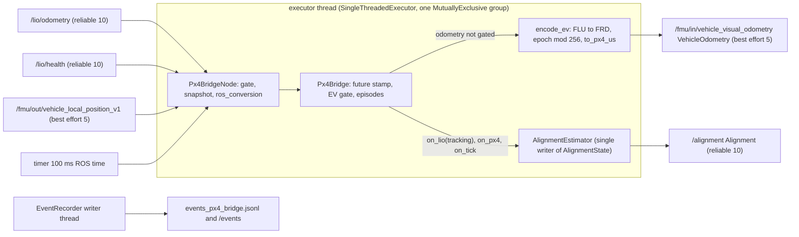

**Alignment như trong code** (`alignment.hpp` `kAlignmentTransitions`, `alignment.cpp`):

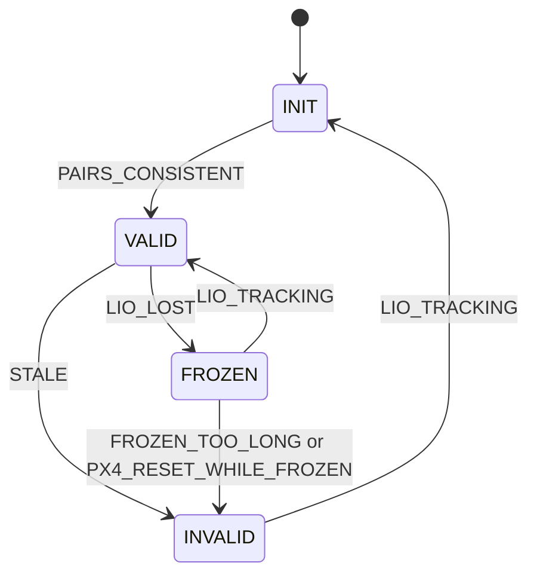

| Từ | Tới | Reason | Điều kiện trong code (beta `config/px4_bridge/sim.yaml`) |
|---|---|---|---|
| INIT | VALID | `PAIRS_CONSISTENT` | `alignment_consistent_pairs` (20) cặp nhất quán với trung bình đang chạy tại vị trí xe, rồi kiểm lại mọi thành viên với trung bình cuối; `T` = trung bình |
| VALID | FROZEN | `LIO_LOST` | `on_lio(tracking = false)` (mọi health không TRACKING) |
| FROZEN | VALID | `LIO_TRACKING` | odometry tracking; cặp đi kèm xử lý như VALID (nếu bị cổng nhảy thì báo `PAIR_REJECTED_JUMP`, `T` giữ nguyên) |
| VALID | INVALID | `STALE` | không có cặp được nhận quá `alignment_valid_stale_s` (1.0 s), xét ở `on_lio` và `on_tick` |
| FROZEN | INVALID | `FROZEN_TOO_LONG` | FROZEN quá `alignment_frozen_max_s` (10 s) |
| FROZEN | INVALID | `PX4_RESET_WHILE_FROZEN` | bộ đếm reset PX4 đổi khi FROZEN |
| INVALID | INIT | `LIO_TRACKING` | odometry tracking; tích luỹ mới bắt đầu từ cặp **kế tiếp** |

Không đổi trạng thái: reset PX4 ở VALID/INVALID áp phép đổi hệ G lên `T` và buffer (`PX4_RESET_APPLIED`); ở INIT áp G
rồi bắt đầu lại tích luỹ; health không TRACKING ở INIT bắt đầu lại tích luỹ; cặp ở VALID: lệch tại xe
> `alignment_jump_position_m` (0.5 m) hoặc > `alignment_jump_yaw_rad` (0.0873) → `PAIR_REJECTED_JUMP`, ngược lại một bước
lọc `alpha = clamp(dt, 1 ms, 200 ms) / alignment_tau_s` (2.0 s); không có cặp PX4 trong ±`kPairingWindow` 50 ms →
`NO_PX4_SAMPLE`. `go()` từ chối cạnh không có trong bảng (assert ở debug).

**Scan chờ mẫu PX4 (DV2, [đo](../analysis/2026-10-s1c-dv2.md)).** Scan có stamp sau mẫu PX4 mới nhất trong buffer (buffer
không rỗng) thì **chờ**: `on_lio` trả `NONE`, không đổi gì. Chỉ một scan chờ (`waiting_`, dữ liệu input, không phải trạng
thái). Kết thúc:

| Sự kiện | Kết quả |
|---|---|
| mẫu PX4 được nhận, stamp ≥ scan, không mang reset | ghép như ở `on_lio` (`PAIR_ACCEPTED`, `PAIRS_CONSISTENT`, `PAIR_REJECTED_JUMP`), hoặc `NO_PX4_SAMPLE` nếu một phía vượt 50 ms |
| mẫu PX4 stamp < scan, hoặc mẫu mang reset | vẫn chờ (mẫu kế tiếp quyết, trên buffer đã áp G) |
| input LIO mới hơn qua kiểm 1–2 | bỏ scan chờ; nếu chính scan mới phải chờ thì báo `NO_PX4_SAMPLE` cho scan bị bỏ |
| đổi trạng thái (`go()`) | bỏ scan chờ (cặp chỉ quyết trong trạng thái scan tới) |

Vì vậy cạnh INIT → VALID có thể xảy ra trong `on_px4`; bảng cạnh không đổi. Bridge báo kết quả đó trên luồng odometry
(`input` 0, `sensor_time_s` = stamp scan); scan chờ chưa đóng đợt từ chối của odometry, cặp được nhận mới đóng.

**Cổng EV và ghép input (`Px4Bridge`, `bridge.hpp`).**

| Input | Quy tắc trong code |
|---|---|
| mọi input | stamp > tick mới nhất + 500 ms (`kMaxStampAhead`) → từ chối `STAMP_IN_FUTURE` trước mọi kiểm khác |
| `/lio/odometry` | **bị chặn** (`EvGated`, `HEALTH_NOT_TRACKING`) khi health mới nhất **cùng epoch** không TRACKING và stamp health ≥ stamp odometry; không thì `encode_ev` (epoch của chính mẫu, F14; EV gửi ngay cả khi cặp phải chờ, D42) và độc lập `on_lio(tracking = true)` với pose FRD |
| `/lio/health` | health cũ hơn health đã lưu cùng epoch → `OUT_OF_ORDER`, không đổi gì; mọi health không TRACKING → `on_lio(false)`; TRACKING chỉ cập nhật cổng |
| `vehicle_local_position` | `!xy_valid` hoặc `!z_valid` → `Px4SampleRejected` `PX4_POSITION_INVALID` (bộ đếm reset chưa tiêu); hợp lệ → `on_px4` |
| tick | `on_tick(now)` mỗi `kTickPeriod` 100 ms: hai timeout của alignment |

`encode_ev`: thứ tự kiểm `NOT_TRACKING`, `TIME`, `NON_FINITE_STATE`, `BAD_QUATERNION`, `BAD_COVARIANCE`;
`pose_frame = velocity_frame = 2` (FRD), `reset_counter = epoch % 256`, `quality` chép từ LIO (>100 → 0),
`timestamp_sample` = µs của `to_px4(SensorTime, kSimulationIdentity)`.

**Đợt từ chối (episode).** Một slot = (event, luồng input, reason). Lần đầu của đợt phát ngay, các lần sau đếm (phát lại
mỗi 1000 lần); input **được nhận** kế tiếp của luồng đó đóng đợt bằng một bản tóm tắt (`summary` 1, `count`,
`suppressed`). `flush(now)` đóng mọi đợt khi tắt. Event lõi: `AlignmentTransition`, `Px4ResetApplied`,
`AlignmentPairRejected`, `AlignmentAccumulationRestarted`, `EvGated`, `EvRejected`, `Px4SampleRejected`,
`LioInputRejected`. Event node: `BridgeNoRosTime`, `BridgePublishFailed`, `BridgeNodeFailed`, `BridgeNodeSummary`.

**Khởi động và tắt của node.** Khởi động: tham số `config_file` (`kAlignmentSpecs`), `events_jsonl`; recorder; bridge;
hai publisher; một group; **một `on_tick` trước khi tạo subscription** (bỏ qua nếu ROS time còn 0; khi đó callback đầu
tiên tự tick, `first_tick` ghi đường nào); rồi ba subscription và timer `create_timer(100 ms)` trong cùng group.
Tắt (`shutdown()`, từ pre-shutdown callback hoặc destructor): (1) đóng cổng callback, chờ callback đang chạy;
(2) `Px4Bridge::flush(now)`; (3) `BridgeNodeSummary` (bản ghi cuối); (4) huỷ bridge, rồi recorder.

**Bằng chứng.** `Alignment.TransitionTableIsTheSpecDiagram`, `AlignmentFuzz.EveryStateChangeIsAListedEdge`,
`Alignment.FarFromOriginYawNoiseStaysValid`, `Alignment.AppliesDoubleResetDeltas`, `Alignment.ResetCounterWrapIsAReset`,
`EvEncoder.LabelsFrdNotNed`, `EvEncoder.UsesSampleEpochAsResetCounter`, `Px4Bridge.NewerNonTrackingHealthBlocksEv`,
`Px4Bridge.LioLostStopsEvAndFreezesAlignment`, `Px4Bridge.EachFaultEpisodeIsReported`,
`Px4BridgeNode.PublishesEvAndAlignmentFromLioAndPx4Streams`, `Px4BridgeNode.MultiThreadedExecutorKeepsCallbacksSerialised`,
`Px4Time.NegativeRejected`; DV2: `Alignment.ScanAheadOfTheNewestPx4SampleWaitsAndPairsWithTheNextSampleAfterIt`,
`Alignment.WaitingScanInInitCompletesTheAccumulation`, `Alignment.NewerScanDropsTheWaitingScanAsNoPx4Sample`,
`Alignment.StateChangeDropsTheWaitingScan`, `Alignment.ResetSampleDoesNotDecideTheWaitingScanTheNextSampleDoes`,
`Alignment.PairingWindowIsFiftyMillisecondsOnEachSide`, `Px4Bridge.OdometryAheadOfPx4IsPairedByTheNextPx4Sample`,
`Px4Bridge.WaitingOdometryWithoutAPx4SampleInTheWindowIsReported`,
`Px4Bridge.WaitingOdometryDroppedByANewerOneIsReportedWithItsStamp` (fuzz có thêm scan phải chờ). SITL: bốn hover F34 (`run:20261013T154709Z-gps-hover`, `run:20261013T154923Z-gps-hover-yaw1.2`,
`run:20261013T155144Z-no_gps-hover`, `run:20261013T155429Z-no_gps-hover-yaw1.2`: `yaw_T` dao động ≤ 0.08°, drift ≤ 0.034 m),
`run:20261013T163717Z-gps-hover` (2 reset PX4 không phá VALID), `run:20261013T162711Z-gps-altitude_sweep` (EV dừng,
`T` VALID → FROZEN → INVALID).

**Lệch so với thiết kế.**
- §4.1 "`timestamp_sample` đổi sang đồng hồ PX4 qua timesync": code chỉ có `kSimulationIdentity`; `kRealtime` bị từ chối
  (beta là SITL, §0). Phần cứng cần bộ ước lượng offset chưa có.
- §4.1 "`T` gắn với một epoch LIO" (D47) và bỏ `frozen_max` (D48) **chưa có** (S1c Task 4 Steps 1–4): FROZEN → VALID
  nhận mọi epoch, cạnh `FROZEN_TOO_LONG` và `alignment_frozen_max_s` vẫn còn.
- §4.1/O22/O25: odometry của epoch cũ đến sau health của epoch mới **không bị chặn** (ghi trong `bridge.hpp`).
- §4.1 chưa ghi quy tắc scan chờ mẫu PX4 (DV2, ở trên); code thực hiện đúng câu "pose PX4 nội suy tại đúng thời điểm đó".

**Chưa xây / giới hạn.** Mã state health ngoài phạm vi bị node từ chối (`NOT_FINITE`) nên không đóng băng `T` (carry-over
S2). Hai reset PX4 trong cùng một cửa sổ mẫu bị mất chỉ áp delta cuối; cổng nhảy là lớp chặn cuối. Thời gian chờ publish
`/alignment` (reliable) khi reader chậm chưa đo.

Verified at: `409c4b9`

## uavnav_bringup

Gói launch (D33/O19): `launch/s1_estimation.launch.py` khởi động bốn process với `use_sim_time: true`, mỗi process có
`on_exit = Shutdown` (một process thoát là cả launch dừng). Mục này vẽ cả harness SITL quanh nó (`tools/uavnav/sitl_hover.*`,
`tools/simulation/run_px4_mid360.sh`, `src/sim`, `config/`), vì đó là môi trường mà mọi bằng chứng `run:` đến từ đó.

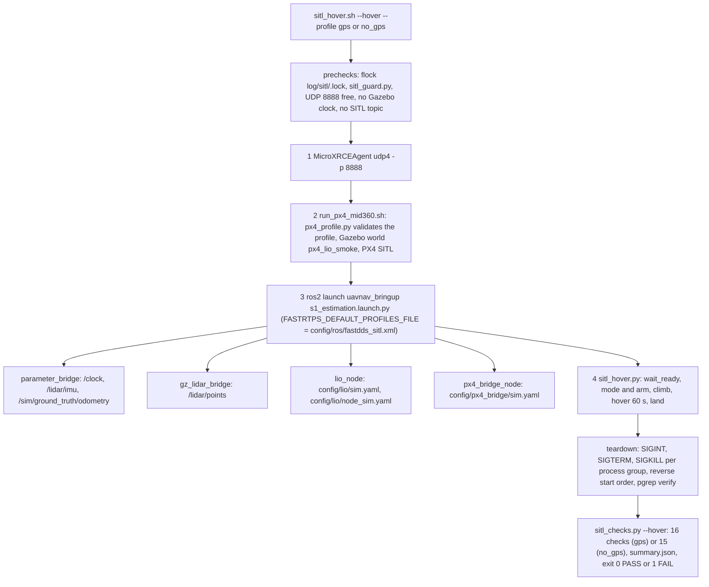

| Launch argument (không mặc định) | File | Loader |
|---|---|---|
| `lio_config` | `config/lio/sim.yaml` | `uavnav::lio::load_lio_config` (`kLioSpecs`, 23 khoá) |
| `lio_node_config` | `config/lio/node_sim.yaml` | `uavnav_lio` `kLioNodeSpecs` (6 khoá mount) |
| `bridge_config` | `config/px4_bridge/sim.yaml` | `load_alignment_config` (`kAlignmentSpecs`, 6 khoá) |
| `events_dir` | thư mục chạy `log/sitl/<id>/` | node mở `events_lio.jsonl`, `events_px4_bridge.jsonl` |

| File config khác | Ai đọc |
|---|---|
| `config/px4/profiles/gps.yaml`, `no_gps.yaml` (tầng c) | `tools/uavnav/px4_profile.py` (allow-list, từ chối khoá lạ), qua `run_px4_mid360.sh` |
| `config/ros/fastdds_sitl.xml` | Fast DDS của các process ROS 2 do harness khởi động (SHM 16 MB + UDPv4); không cho MicroXRCEAgent, PX4, hay launch sản phẩm |
| `src/sim/uav_simulation/bridge/px4_mid360_control_bridge.yaml` | `parameter_bridge` (`/clock` từ `/world/px4_lio_smoke/clock`, `/lidar/imu` từ `/sim/mid360/imu`, ground truth) |
| `config/runtime/*` (di sản `main`) | không có loader nào trên nhánh (grep) |

**Tham số PX4 như được áp** (`px4_gz.log` của mỗi run in dòng `PX4 parameter`; `px4_profile.py` từ chối mọi giá trị khác, và từ chối riêng profile tắt la bàn: `SYS_HAS_MAG=0` hay `EKF2_MAG_TYPE=5`):

| Tham số | `gps` | `no_gps` | Nguồn |
|---|---|---|---|
| `EKF2_EV_CTRL` | 15 | 15 | profile (D42) |
| `EKF2_GPS_CTRL` | 7 | 0 | profile (O23) |
| `EKF2_HGT_REF` | 1 | 3 | profile (O23) |
| `EKF2_EV_QMIN`, `EKF2_EV_DELAY`, `EKF2_EV_NOISE_MD` | 0 | 0 | profile (D28, O23) |
| `EKF2_DELAY_MAX` | 200 | 200 | profile (O23) |
| `UXRCE_DDS_SYNCT` 0, `SIM_GZ_EN_ODOM` 0, `SIM_GZ_EN_GPS` 1, `COM_RC_IN_MODE` 1, `SYS_HAS_MAG` 1 (la bàn bắt buộc, D42) | có | có | harness (`run_px4_mid360.sh`) |
| `NAV_DLL_ACT` 0 (mặc định x500 là 2, từ chối mọi lệnh arm khi không có GCS), `CBRK_SUPPLY_CHK` 894281 (SITL này không phát `system_power`) | có | có | harness (`px4_mid360_startup.sh`, đặt sau rcS) |

Mọi tham số EKF2 khác giữ mặc định PX4 (thư mục làm việc PX4 mới mỗi lần chạy). Sàn EV mà bộ chấm báo cáo
(`EKF2_EVP_NOISE` 0.1 m, `EKF2_GPS_P_NOISE` 0.5 m) là mặc định đó, không phải tham số của profile.

**Nguồn heading PX4 thật sự dùng** (đo, [báo cáo EV đầy đủ](../analysis/2026-10-s1c-ev-full.md)): `gps` chọn la bàn
(`mag_hdg` rồi `mag_3d`) và, khi GNSS còn được fuse, không bao giờ bắt đầu EV yaw (hai chuyến bay); `no_gps` căn la bàn trước, rồi chuyển sang EV yaw với một
reset heading khoảng −20° trước VALID đầu tiên của `T`.

**Pha của driver (`sitl_hover.py`).** `wait_ready` ≤ 90 s (LIO TRACKING, `/alignment` VALID, `cs_ev_pos`, `xy_valid`/`z_valid`)
→ mode + arm (POSCTL bằng stick giữa trên `/fmu/in/manual_control_input` 20 Hz; `--hover-mode hold`: NAV_TAKEOFF rồi Hold)
→ climb ≤ 20 s lên 2.5 m → hover 60 s thời gian `/clock` (cửa sổ chấm) → land. Tuỳ chọn tiêm mất GNSS (`GNSS_OUTAGE_S`,
`--gnss-outage-s`, `SYS_FAILURE_EN`) đã **gỡ** ở `52fbf46`: PX4 v1.17 với GNSS của `gz_bridge` bỏ qua `VEHICLE_CMD_INJECT_FAILURE`
(không ack, GNSS vẫn fuse; `run:20261014T062427Z-gps-hover-yaw1.2-gnssout10`) và owner không cho đổi tham số PX4 khi đang
bay, nên harness không tạo được mất GNSS. `--pattern
altitude_sweep`: bước 2.5 m tới 20 m, giữ 10 s mỗi bước, chỉ kiểm dữ liệu.

Bộ chấm hover (`52fbf46`): `<mode>_accepted`, `ekf2_ev_pos` (≥ 95% thời gian, mỗi mẫu cờ giữ tới mẫu sau),
`ekf2_heading` (báo cáo: tỉ lệ nguồn heading, dòng thời gian, mọi reset heading), `lio_tracking`, `lio_flap_rate`,
`alignment_valid`, `alignment_rate` (≥ 9 Hz), `alignment_jump_rejections` (≤ 1%), `drift` (≤ 0.3 m so ground truth),
`lio_state_rate` (kèm khoảng cách đến theo wall time để đối chiếu), `ev_age`, `px4_time_identity`, `events` (0
`LioQueueOverflow`, `LioBackendFailed`, `ImuRateTooHigh`, `EventsDropped`, `LioNodeFailed`, `BridgeNodeFailed`,
`LioPublishFailed`, `BridgePublishFailed`, `LioIngestReentered`; `LioNodeSummary.publish_failed` 0), `f34_values`
(D42: cửa sổ tách ở mỗi `Px4ResetApplied` và mỗi output không VALID; độ trải `yaw_T` ≤ 1° trong từng đoạn VALID,
và `T` VALID sau mọi `Px4ResetApplied`; giá trị `yaw_T` chỉ báo cáo), `ev_variance` (báo
cáo σ EV so với sàn PX4), và chỉ ở gps `gnss_consistency` (`cs_gnss_pos` ≥ 95% thời gian cửa sổ). Check nào thiếu dữ liệu thì FAIL, kể cả check chỉ báo cáo. Giới hạn cứng 300 s (hover),
240 s (probe).

**Bằng chứng.** `test_s1_estimation_launch.py` (`test_required_arguments_have_no_default`,
`test_starts_the_four_processes_with_sim_time_and_shutdown_on_exit`); `test_px4_profile`; mọi run trong
[sổ SITL](../analysis/2026-10-s1b-sitl-runs.md), hover cuối S1b `run:20261013T232211Z-gps-hover`; EV đầy đủ (S1c-T1,
[sổ S1c](../analysis/2026-10-s1c-sitl-runs.md)): `run:20261014T061438Z-gps-hover-yaw1.2`,
`run:20261014T062206Z-no_gps-hover-yaw1.2` (PASS); test `Px4ProfileTest.test_d42_ev_ctrl_is_full_in_both_profiles`,
`Px4ProfileTest.test_compass_is_mandatory`, `SitlChecksTest.test_f34_passes_on_any_stable_offset`,
`SitlChecksTest.test_f34_splits_the_window_at_resets_and_non_valid_outputs`, `SitlChecksTest.test_gnss_fused_in_95_percent_of_the_window_gps`. Lần
`run:20261013T151158Z-gps-hover` FAIL do thiếu profile Fast DDS (mất ~15% cloud), là lý do có `fastdds_sitl.xml`.

**Lệch so với thiết kế.**
- §0/§4.1 (D42): khớp từ `a693bcf` (`EKF2_EV_CTRL=15` ở cả hai profile; F34 theo độ ổn định của `T`, từng đoạn VALID từ
  `52fbf46`). Hành vi khi mất GNSS ở gps **chưa kiểm chứng**: PX4 bỏ qua lệnh tiêm, vế lần 3 của quy tắc plan không được
  đánh giá, và để lại cho phần cứng (không task nào đảm nhận). EV đầy đủ được giữ làm mặc định D42.
- §4.1 (DV2): ở `run:20261014T062427Z-gps-hover-yaw1.2-gnssout10`, chuỗi `NO_PX4_SAMPLE` dài hơn 1 s đưa `T` VALID→INVALID
  (STALE) rồi INIT→VALID trong cửa sổ hover; LIO vẫn TRACKING. Thuộc DV2 (S1c Task 4); nguyên nhân còn mở (số đo ở
  recorder không giải thích hai lần S1b EV=7).
- §6.2 tầng (c): "Runner đặt tham số PX4 theo profile" có, nhưng chỉ trong harness SITL; không có runner sản phẩm.
- Profile Fast DDS là cấu hình harness, không phải sản phẩm: đường truyền cloud trên phần cứng (Livox driver, S2) chưa
  được kiểm (ghi trong comment của XML).
- §6.6: không có respawn; một process thoát làm cả launch dừng (`Shutdown`), đúng beta.

**Chưa xây / giới hạn.** Launch chỉ có cấu hình SITL (`*_sim.yaml`). Không có launch cho `navigation`, `px4_mode`. POSCTL
(nav_state 2) có ngay từ bản ghi đầu, chưa phân biệt do stick hay mặc định PX4 (TRACEABILITY O24). Chưa có fault injection
(cắt LiDAR) trong harness (S1c Task 5).

Verified at: `52fbf46`

## Updating this document

- **Khi nào:** cùng lát với việc làm, chậm nhất ở task đóng lát, khi một phần đã `COMPONENT_VERIFIED` trở lên và cấu trúc
  không còn đổi (thread, topic, QoS, hàng đợi, bảng trạng thái, cổng). Báo cáo task ghi dòng `As-built:`.
- **Cách làm:** đọc lại code của package, vẽ lại sơ đồ và bảng cạnh từ code (không từ SYSTEM_DESIGN), cập nhật bằng chứng
  (`Suite.Name`, `run:<id>`), rồi ghi `Verified at:` bằng `git rev-parse --short HEAD` của commit chứa code đã đọc.
- **Kiểm:** `python3 -m tools.uavnav.arch_check` (thiếu mục, thiếu Mermaid hay commit lạ là ERROR; cũ hơn code quá
  `as_built_stale_commits` là WARN), `python3 tools/check_documentation.py . docs`.
- **Quan hệ:** SYSTEM_DESIGN là ý định, AS_BUILT là hiện trạng. Chỗ khác nhau phải thành `DV*` trong TRACEABILITY hoặc một
  D\* sửa spec; không để hai bản nói khác nhau mà không ai ghi. Phần chưa xây chỉ được liệt kê, không được vẽ theo thiết kế.
